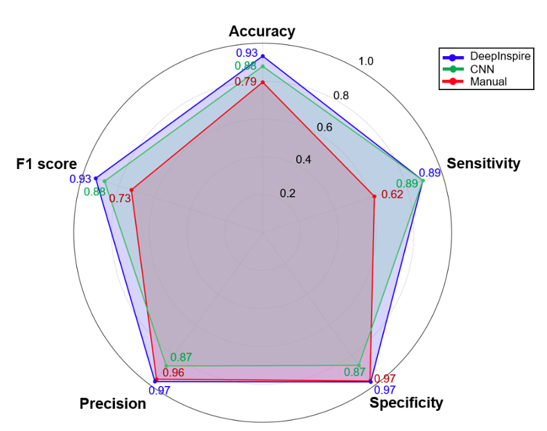
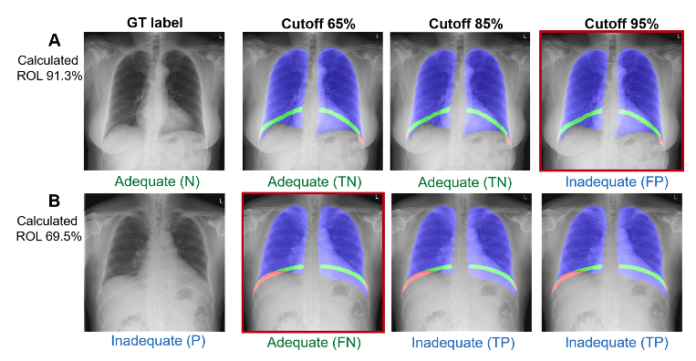

# DeepInspire 🩻

Code for **DeepInspire**, a deep learning framework for automated assessment of inspiratory adequacy on posteroanterior (PA) chest radiographs.

DeepInspire segments the lung fields and the 9th posterior ribs (MA-Net with a ResNet34 encoder) and calculates the **rib-over-lung (ROL)** value, the percentage of the 9th posterior rib area that lies inside the lung fields. A radiograph is classified as adequate inspiration when its ROL is above the cutoff of 83.9%, chosen on the training set with the Youden index. A lower value means that more of the rib lies below the lung fields, which indicates inadequate inspiration.





## Data and trained models

The de-identified radiographs, annotation masks, metadata, readers' results and the three trained models are available on Zenodo:

> Wongtrakool, P., & Chousangsuntorn, K. (2026). DeepInspire dataset and trained models for automated assessment of inspiratory adequacy on posteroanterior chest radiographs [Data set]. Zenodo. <https://doi.org/10.5281/zenodo.24286276>

The repository itself contains no image data. Download `Data.zip` and `Model.zip` and unzip both next to the repository:

```bash
unzip Data.zip     # creates Data/
unzip Model.zip    # creates Model/
```

This gives:

```text
DeepInspire/                 # this repository
Data/
├── train/ validation/ test/ # each with full/ and not full/, each with image/ and mask/{lung,rib}/
├── human_segment/           # the two observers' masks for the test images
├── metadata.csv             # image, set, label, subject_id, age, sex
└── reader_results.csv       # nine radiological technologists' answers on the test images
Model/                       # the three .pth files
```

"full" means adequate and "not full" inadequate inspiration. The test set (51 images) contains only subjects who did not contribute images to the training or validation sets.

## Repository structure

```text
DeepInspire/
├── train_segment.py             # trains the lung or rib segmentation model (MA-Net, ResNet34 encoder)
├── train_classification.py      # trains the ResNet34 classifier used for comparison
├── Notebook/
│   ├── evaluation.ipynb         # predictions, ROL cutoff, test metrics with 95% CIs, DeLong and McNemar tests,
│   │                            # readers and ICC, segmentation accuracy, Table 1 and Table 2
│   └── visualization.ipynb      # ROL distribution, ROC curves, metrics with CIs, Grad-CAM examples
├── Image/                       # figures for this README
└── requirements.txt
```

## Environment setup

```bash
python -m venv .venv
source .venv/bin/activate
pip install -r requirements.txt
```

## Reproducing the results

Run `Notebook/evaluation.ipynb` and then `Notebook/visualization.ipynb`. Both notebooks are saved with their outputs, so the results can also be read on GitHub without running them. The paths are set in the first code cell (`DATA_DIR`, `MODEL_DIR`, `OUT_DIR`, by default `../../Data`, `../../Model` and `../../results`). Running the models on all images takes a few minutes on a CPU. All 95% CIs come from 10,000 bootstrap resamples with fixed random seeds, so the numbers are identical between runs.

## Training

```bash
# segmentation models
python train_segment.py --organ rib  --train_data_dir ../Data/train --valid_data_dir ../Data/validation
python train_segment.py --organ lung --train_data_dir ../Data/train --valid_data_dir ../Data/validation

# classification model
python train_classification.py --train_folder ../Data/train --valid_folder ../Data/validation
```

Other options include `--epochs` (default 100), `--lr` (default 0.0001), `--batch_size` (default 4) and, for segmentation, `--encoder` (default resnet34). See `--help` for the full list.

## Citation

If you use this code, the data or the models, please cite the DeepInspire article (in review) and the Zenodo record above.

## License

This repository is provided for research purposes. Please contact the authors for licensing information.

Mail: [paritt.w@gmail.com](mailto:paritt.w@gmail.com)
